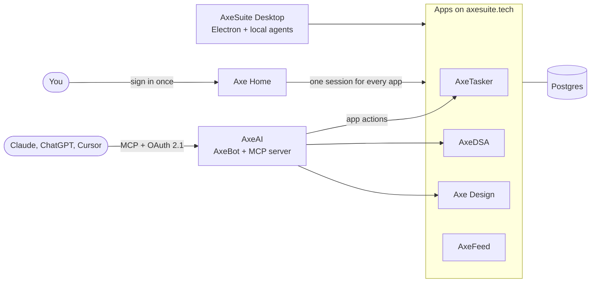

[![Portfolio][badge-portfolio]][portfolio] [![LinkedIn][badge-linkedin]][linkedin] [![Email][badge-email]][email] [![Hugging Face][badge-hf]][hf]

Hey, I'm Vatsal 👋 I build full-stack apps, and lately the AI side of them too: agents, tool calling and MCP servers. Most of my time goes into AxeSuite and my studio, RCIS.

> **I'm open to full-stack and AI engineering roles.** Email is the quickest way to reach me: [vatsalgoyal9999@gmail.com][email]

## What I'm working on

### AxeSuite

A productivity suite for CS students and engineers, and the project I spend most of my time on. It's seven web apps and a desktop app that share one login, one Postgres database and one AI assistant. I build and run all of it myself.

| App | What it does |
| --- | --- |
| [**AxeTasker**](https://tasker.axesuite.tech) | A week-by-week planner with task cards, timers, streaks and notes |
| [**AxeDSA**](https://dsa.axesuite.tech) | Tracks your LeetCode, Codeforces and HackerRank practice, with ready-made problem packs |
| [**Axe Design**](https://design.axesuite.tech) | System design practice. You draw an architecture and a simulator load-tests it |
| [**AxeFeed**](https://feed.axesuite.tech) | A calm daily feed of blogs, newsletters and papers. Paste any link and it finds the feed |
| [**AxeAI**](https://ai.axesuite.tech) | AxeBot, the assistant inside the apps, plus an MCP server so Claude, ChatGPT or Cursor can use your data |
| [**Axe Home**](https://home.axesuite.tech) and [**AxeTips**](https://tips.axesuite.tech) | Sign-in, dashboard, blog and payments, and the user guides |
| **AxeSuite Desktop** | An Electron app for macOS, Windows and Linux. It holds AxeAI, AxeDSA and AxeTasker, works offline, and lets you chat with Claude Code, Codex or Antigravity inside AxeAI |

- **One login for everything.** Sign in once with Google and every app on `*.axesuite.tech` knows it's you. Sign out of one and you're out of all of them. The desktop app signs in through your browser (RFC 8252 with PKCE).
- **The AI follows the apps' rules.** The apps publish what can be done to their data as typed actions. Their own pages use them, and AxeAI calls the same ones with short-lived signed tokens, so none of that logic gets copied into the AI.
- **Bring your own AI.** The MCP server (OAuth 2.1, 40 tools) lets Claude, ChatGPT or Cursor work with your stuff. AxeBot runs on LangGraph with whatever model and API key you pick.
- **Works offline.** Tasker, DSA and AxeAI open without internet, keep your changes on the device and sync them when you're back, a bit like Google Docs.
- **A load-test simulator.** Axe Design pushes traffic through your design and works out the load on each part, p99 latency, availability and the monthly bill. Any design that holds up passes.
- **Feeds for sites that don't have one.** AxeFeed falls back to sitemaps, or just watches the page for new links.

Next.js, React, TypeScript, Tailwind, Postgres (Neon), LangChain, LangGraph, MCP, Electron, Vitest, Playwright, Vercel

The code is private, but every app above is live. Most of my commits go there (500+ so far), which is why my contribution graph looks busier than my public repos.

### RCIS

[RCIS][rcis] is my web development studio, built around one idea: a website delivered in 10 minutes, with no lock-in, and a real developer who can step in and do the work whenever it's needed. We also build the systems behind websites, like order management, dashboards and internal tools.

- The studio site is Next.js with no CSS framework, and the night sky behind it is a shader I wrote in raw GLSL. Switch to the light theme and the same sky looks like it was printed on paper.
- Clients get their own portal to follow their project and message the studio, and partners get one too. There are no sign-ups. The studio issues every account.
- Our internal tooling is a mix of AI-assisted tools, deterministic tools, helpers, authorisation and much more. It's how we run a website delivery service like no other. From Next.js to WordPress with Elementor, we do it all.

Next.js, TypeScript, WordPress, Elementor, GLSL, Supabase, Python

### PocketLM

How much of a model's worldview comes from its data? I trained eight small models on my MacBook, on posts from politically opposite Reddit communities, and compared what they said. Six are LiquidAI's LFM2-1.2B fine-tuned with LoRA (on MLX and PEFT), and two are 124M GPT-2s trained from scratch with nanoGPT. For those two, a FAISS dedup pass kept both datasets clean and the same size. A small React and Node app runs the models side by side.

[Code][pocketlm] and [weights][pocketlm-hf] are open. PyTorch, MLX, LoRA, FAISS, TypeScript

### FT7

An AI-enabled trading system on [Flattrade](https://flattrade.in)'s API. It uses AI to trade, inside hard limits on position size, trades per day and losses, and a single kill switch file blocks every script that can place an order. Around it:

- a live market viewer I packaged as a Mac app with Electron, showing every raw API reply next to the charts built from it
- a Python client, with a fix for a login bug in the NorenRestApi library
- an API recorder that called every endpoint and turned the replies into a PDF report, which is how I found the limit of 10 orders a second

Orders go out through a Tailscale exit node on AWS, so they always come from the IP the broker whitelisted. Not public. Python, Electron, WebSockets, pandas, AWS, Tailscale

### Gleck (in development)

My personal AI agent, still in the works. The idea is that it keeps my resumes and portfolio up to date, hunts for jobs, sends mail and helps with research, all running locally. LangGraph, LangChain and MCP. I'm building it on GitLab for now and releases will land in [the GitHub repo][gleck].

<b>Other stuff I've built</b>

- **[GlobalFreight AI][globalfreight]**: built solo for a company-wide AI hackathon at Pratham Software (Intellithon, AI-Fortnight 2026), where it cleared all four rounds. A logistics platform that goes from a RAG policy assistant up to Planner, Executor and Auditor agents running the network through an MCP server, under hard safety rules. Flask, LangGraph, ChromaDB, Next.js 16.
- **[vatsalgoyal.com][portfolio]**: my portfolio. Glass hexagons over a single WebGL shader, no animation libraries. [Source][portfolio-src]
- **[JobNest][jobnest]**: a job portal I built during my internship at Xebia. MERN, JWT auth, Stripe and Razorpay, Socket.io.
- **[450 House of Sourdough][450]**: client work for a bakery. The storefront, plus a Flask and SQLite system for orders, subscriptions and B2B accounts ([source][450-backend]).
- **AxeServer**: an old PC I turned into a 24/7 Ubuntu server on Tailscale. It's where I test agents like Gleck.
- **AshaKiran**: a website for an NGO, built with React, Node and Postgres.
- Smaller things: [movie.fy][moviefy] (Flutter), [Flapper][flapper] (a Flappy Bird-style game I packaged for iOS with Capacitor) and a [VS Code setup][vscode-dsa] that runs DSA code in seven languages with one shortcut.

## Experience

- **Full-stack development intern**, [Pratham Software (PSI)][psi] · Jan to Aug 2026. Worked on an internal application using the PERN stack (PostgreSQL, Express, React and Node).
- **IT consultant**, 450 House of Sourdough · Jun to Nov 2025. Built and deployed the bakery's web platform: online orders, payments and inventory.
- **Full-stack intern**, Xebia · Jun to Jul 2025. Built JobNest.
- **Part-time web developer**, Digispheres · Jul 2023 to Jul 2024. Built and deployed websites for clients.

**Education:** B.Tech in Computer Science and Engineering (full-stack development specialization) · 2022 to 2026

## Achievements and certifications

- **Oracle Cloud certifications (2025):** Generative AI Professional, AI Vector Search, AI Foundations, Data Platform Foundations and OCI Foundations
- **Smart India Hackathon:** 7th place in the inter-college competition
- **College coding contests:** 1st place in Code-O-Mania and Algo vs Logic

## Tools I use

<picture>
  <source media="(prefers-color-scheme: dark)" srcset="https://skillicons.dev/icons?i=ts%2Cjs%2Cpy%2Ccpp%2Cswift%2Creact%2Cnextjs%2Ctailwind%2Cnodejs%2Cexpress%2Cflask%2Cvite%2Cpostgres%2Csupabase%2Cmongodb%2Csqlite%2Cpytorch%2Celectron%2Cflutter%2Caws%2Cvercel%2Cdocker%2Cgithubactions%2Clinux%2Cbash%2Cgit%2Clatex&theme=dark&perline=14">
  
</picture>

Also: LangChain, LangGraph, MCP, RAG, MLX, LoRA, FAISS, ChromaDB, WebGL and GLSL, Radix UI, Tiptap, React Flow, Vitest, Playwright, Tailscale and the Agent Client Protocol

## GitHub activity

  <picture>
    <source media="(prefers-color-scheme: dark)" srcset="https://streak-stats.demolab.com?user=masterunix&theme=tokyonight&hide_border=true">
    
  </picture>

  <picture>
    <source media="(prefers-color-scheme: dark)" srcset="https://raw.githubusercontent.com/masterunix/masterunix/output/github-snake-dark.svg">
    
  </picture>

---

Thanks for stopping by! If you're hiring, or want to build something together, [email me][email] or find me on [LinkedIn][linkedin].

> "Just do it."

Last updated 19 Oct 2026 · v3.2

[portfolio]: https://www.vatsalgoyal.com
[linkedin]: https://www.linkedin.com/in/vatsalgoyal93
[email]: mailto:vatsalgoyal9999@gmail.com
[hf]: https://huggingface.co/axe-net
[rcis]: https://rcis-systems.vercel.app
[pocketlm]: https://github.com/masterunix/PocketLM
[pocketlm-hf]: https://huggingface.co/axe-net/PocketLM
[gleck]: https://github.com/masterunix/gleck
[globalfreight]: https://github.com/masterunix/FOURTH-AGENT
[portfolio-src]: https://github.com/masterunix/portfolio-frontend
[jobnest]: https://github.com/masterunix/JobNest-v1
[450]: https://450-hos-static.vercel.app
[450-backend]: https://github.com/masterunix/450Backend
[moviefy]: https://github.com/masterunix/Fluttter-Movie-App
[flapper]: https://github.com/masterunix/flapper
[vscode-dsa]: https://github.com/masterunix/VS-Code-DSA-Setup
[psi]: https://www.thepsi.com

[badge-portfolio]: https://img.shields.io/badge/vatsalgoyal.com-7C3AED?style=flat-square&logo=data:image/svg%2bxml;base64,PHN2ZyB4bWxucz0iaHR0cDovL3d3dy53My5vcmcvMjAwMC9zdmciIHZpZXdCb3g9IjAgMCAyNCAyNCIgZmlsbD0ibm9uZSIgc3Ryb2tlPSIjZmZmIiBzdHJva2Utd2lkdGg9IjIiIHN0cm9rZS1saW5lY2FwPSJyb3VuZCIgc3Ryb2tlLWxpbmVqb2luPSJyb3VuZCI+PGNpcmNsZSBjeD0iMTIiIGN5PSIxMiIgcj0iMTAiLz48cGF0aCBkPSJNMTIgMmExNC41IDE0LjUgMCAwIDAgMCAyMCAxNC41IDE0LjUgMCAwIDAgMC0yMCIvPjxwYXRoIGQ9Ik0yIDEyaDIwIi8+PC9zdmc+
[badge-linkedin]: https://img.shields.io/badge/LinkedIn-0A66C2?style=flat-square&logo=data:image/svg%2bxml;base64,PHN2ZyB4bWxucz0iaHR0cDovL3d3dy53My5vcmcvMjAwMC9zdmciIHZpZXdCb3g9IjAgMCAyNCAyNCI+PHBhdGggZmlsbD0iI2ZmZiIgZD0iTTIwLjQ0NyAyMC40NTJoLTMuNTU0di01LjU2OWMwLTEuMzI4LS4wMjctMy4wMzctMS44NTItMy4wMzctMS44NTMgMC0yLjEzNiAxLjQ0NS0yLjEzNiAyLjkzOXY1LjY2N0g5LjM1MVY5aDMuNDE0djEuNTYxaC4wNDZjLjQ3Ny0uOSAxLjYzNy0xLjg1IDMuMzctMS44NSAzLjYwMSAwIDQuMjY3IDIuMzcgNC4yNjcgNS40NTV2Ni4yODZ6TTUuMzM3IDcuNDMzYTIuMDYyIDIuMDYyIDAgMSAxIDAtNC4xMjUgMi4wNjIgMi4wNjIgMCAwIDEgMCA0LjEyNXpNNy4xMTkgMjAuNDUySDMuNTU1VjloMy41NjR2MTEuNDUyek0yMi4yMjUgMEgxLjc3MUMuNzkyIDAgMCAuNzc0IDAgMS43Mjl2MjAuNTQyQzAgMjMuMjI3Ljc5MiAyNCAxLjc3MSAyNGgyMC40NTFDMjMuMiAyNCAyNCAyMy4yMjcgMjQgMjIuMjcxVjEuNzI5QzI0IC43NzQgMjMuMiAwIDIyLjIyMiAwaC4wMDN6Ii8+PC9zdmc+
[badge-email]: https://img.shields.io/badge/Email-EA4335?style=flat-square&logo=gmail&logoColor=white
[badge-hf]: https://img.shields.io/badge/Hugging_Face-FFD21E?style=flat-square&logo=huggingface&logoColor=black
